

<picture>
  <source media="(max-width: 600px)" srcset="assets/profile-v4/header-mobile.svg" />
  
</picture>

### Projects

  <a href="https://github.com/oNxZero/Automater">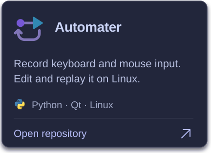</a>
  <a href="https://github.com/oNxZero/CTM-Gen">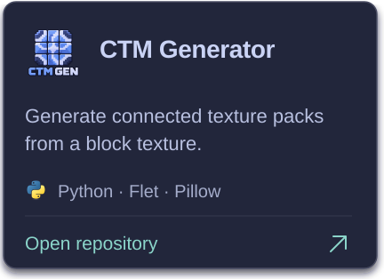</a>
   
  <a href="https://github.com/oNxZero/spuds-shop-reforged">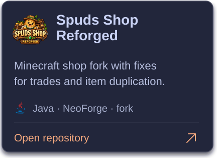</a>
  <a href="https://github.com/oNxZero/NotEnoughRevivesReforged">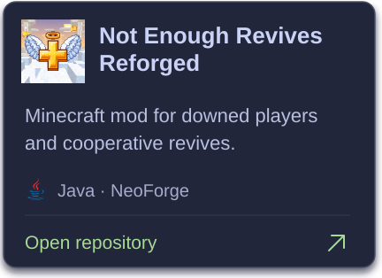</a>

### Skills

Used across my public and private projects. Each logo links to its official site.

  <a href="https://www.python.org/" title="Python — official site">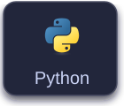</a>
  <a href="https://dev.java/" title="Java — official site">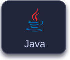</a>
  <a href="https://tc39.es/ecma262/" title="JavaScript — official site">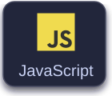</a>
  <a href="https://www.typescriptlang.org/" title="TypeScript — official site">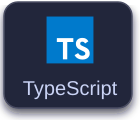</a>
  <a href="https://vuejs.org/" title="Vue — official site">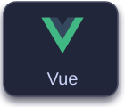</a>
  <a href="https://nodejs.org/" title="Node.js — official site">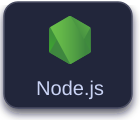</a>
   
  <a href="https://www.qt.io/" title="Qt — official site">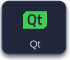</a>
  <a href="https://react.dev/" title="React — official site">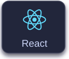</a>
  <a href="https://www.mysql.com/" title="MySQL — official site">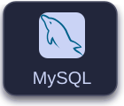</a>
  <a href="https://www.docker.com/" title="Docker — official site">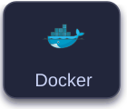</a>
  <a href="https://www.kernel.org/" title="Linux — official site">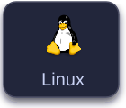</a>
  <a href="https://git-scm.com/" title="Git — official site">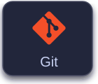</a>

### GitHub activity

<a href="https://github.com/oNxZero?tab=overview">
<picture>
  <source media="(max-width: 600px)" srcset="assets/profile-v4/activity-mobile.svg" />
  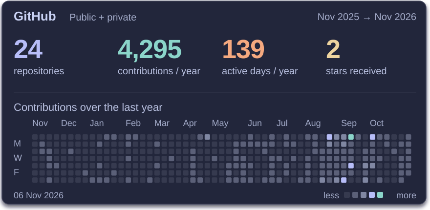
</picture>
</a>

<picture>
  <source media="(max-width: 600px)" srcset="assets/profile-v4/insights-mobile.svg" />
  
</picture>

All public projects

<!-- PROJECTS:START -->

- [AOCrawler](https://github.com/oNxZero/AOCrawler) — Python Crawler for Albion Online
- [county](https://github.com/oNxZero/county)
- [Moonlight](https://github.com/oNxZero/Moonlight) — External Autoclicker for Linux
- [pinger](https://github.com/oNxZero/pinger)
- [rosis-lounge](https://github.com/oNxZero/rosis-lounge) — Minecraft 1.21.1 NeoForge lounge mod with multiplayer shishas, vapes, tobacco farming and drinks
- [snaky](https://github.com/oNxZero/snaky)

<!-- PROJECTS:END -->

Updates daily. [Profile source](https://github.com/oNxZero/oNxZero) · [How the stats work](docs/PROFILE.md)
