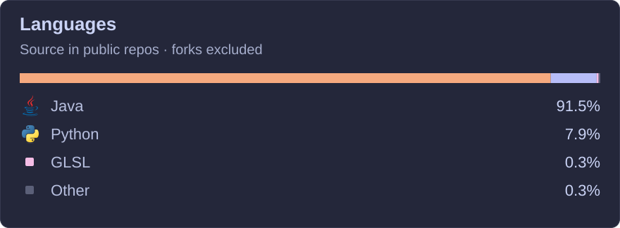

<picture>
  <source media="(max-width: 600px)" srcset="assets/header-mobile.svg" />
  
</picture>

<picture>
  <source media="(max-width: 600px)" srcset="assets/tools-mobile.svg" />
  
</picture>

### Projects

<a href="https://github.com/oNxZero/Automater">
<picture>
  <source media="(max-width: 600px)" srcset="assets/automater-mobile.svg" />
  
</picture>
</a>

<a href="https://github.com/oNxZero/CTM-Gen">
<picture>
  <source media="(max-width: 600px)" srcset="assets/ctm-gen-mobile.svg" />
  
</picture>
</a>

<a href="https://github.com/oNxZero/spuds-shop-reforged">
<picture>
  <source media="(max-width: 600px)" srcset="assets/spuds-shop-reforged-mobile.svg" />
  
</picture>
</a>

<a href="https://github.com/oNxZero/NotEnoughRevivesReforged">
<picture>
  <source media="(max-width: 600px)" srcset="assets/not-enough-revives-mobile.svg" />
  
</picture>
</a>

### GitHub activity

<a href="https://github.com/oNxZero?tab=overview">
<picture>
  <source media="(max-width: 600px)" srcset="assets/activity-mobile.svg" />
  
</picture>
</a>

<picture>
  <source media="(max-width: 600px)" srcset="assets/insights-mobile.svg" />
  
</picture>

<picture>
  <source media="(max-width: 600px)" srcset="assets/languages-mobile.svg" />
  
</picture>

All public projects

<!-- PROJECTS:START -->

- [AOCrawler](https://github.com/oNxZero/AOCrawler) — Python Crawler for Albion Online
- [county](https://github.com/oNxZero/county)
- [Moonlight](https://github.com/oNxZero/Moonlight) — External Autoclicker for Linux
- [Moonlight-Vanity](https://github.com/oNxZero/Moonlight-Vanity)
- [OpenEuphoriaBackup](https://github.com/oNxZero/OpenEuphoriaBackup) — lol
- [pinger](https://github.com/oNxZero/pinger)
- [rosis-lounge](https://github.com/oNxZero/rosis-lounge) — Minecraft 1.21.1 NeoForge lounge mod with multiplayer shishas, vapes, tobacco farming and drinks
- [snaky](https://github.com/oNxZero/snaky)

<!-- PROJECTS:END -->

Updates daily. [Profile source](https://github.com/oNxZero/oNxZero) · [How the stats work](docs/PROFILE.md)
